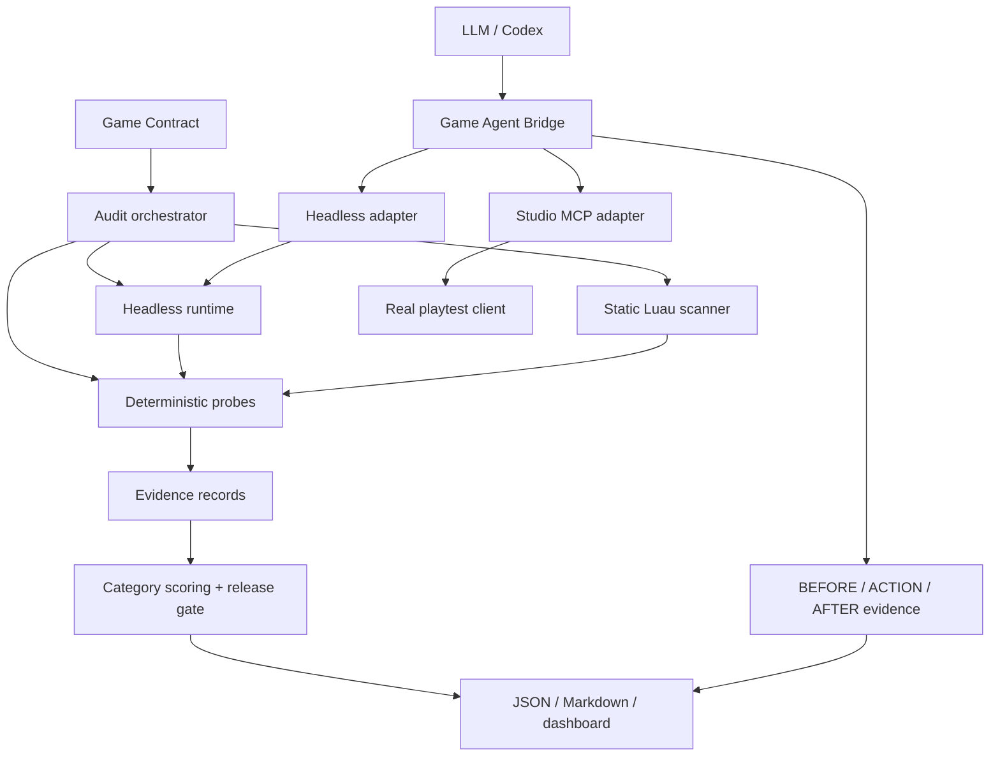

# MVP architecture



## Boundary between proof and diagnosis

The fixture is an explicit adapter for this MVP. It is not presented as a Studio capture. Geometry proof is computed from nine sampled support points, runtime proof is generated by the headless server-authoritative simulation, and static security proof is generated from the source tree.

In a Studio integration, the same probes can consume real raycasts, pathfinding results, console output, screenshots, and MicroProfiler measurements. The evidence schema remains stable so a release judge can compare runs.

The bridge has three observation modes. Black-box is the release proof because it only exposes what a player can see. Gray-box and white-box are diagnostic modes; they can inspect state, UI, nearby instances, raycasts, remotes and logs after the human attempt has already established the failure.

## Release gate

The gate blocks on any critical or major failure. It also enforces the product requirements from the objective:

```text
critical == 0
major == 0
gameplay >= 95
persistence == 100
multiplayer >= 90
```

The `fix` command intentionally emits a plan instead of silently mutating gameplay code. A future Codex adapter can consume the evidence IDs, make a patch, and rerun only affected probes before the full regression suite.
